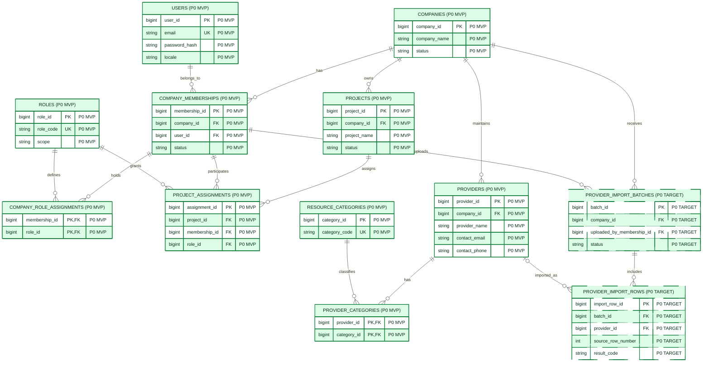
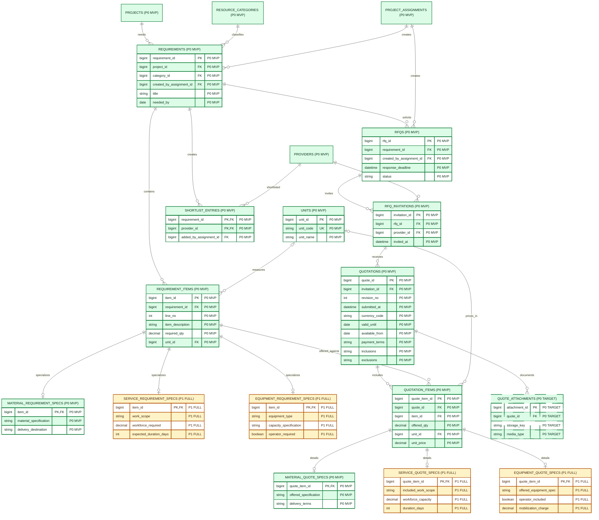
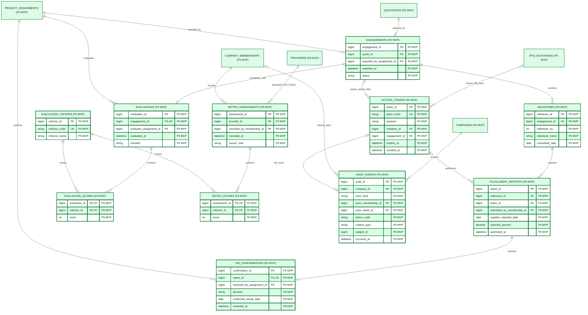

## 1. How to read this model

This **single file** contains four connected Mermaid ER diagrams. Each one is a view of the **same database**; shared entities (for example `PROJECTS`, `PROVIDERS`, `QUOTATIONS`) are repeated as references to connect the views. They are **not duplicate tables**. All relationships use crow's-foot notation. The complete product consists of P0 + P1 + P2; only P0 is required for the initial MVP.

| Visual encoding | Entity / attribute annotation | Intended delivery |
|---|---|---|
| 🟩 Green fill, solid border | `P0 MVP` | Essential initial MVP schema |
| 🟩 Green fill, dashed border | `P0 TARGET` | Planned MVP import/attachment feature; an alternative requires documented team/lecturer approval or safety-gate staging |
| 🟨 Amber fill | `P1 FULL` | Full-product enhancements after P0 |
| ⬜ Gray fill | `P2 FULL` | Later full-product modules |

**Accessibility:** All entities are explicitly named with their scope (`P0 MVP`, `P0 TARGET`, `P1 FULL`, `P2 FULL`), and every displayed attribute is annotated with its scope; color is not the only differentiator. `PK` = primary key, `FK` = foreign key, `UK` = unique key. Scope annotations do **not** indicate nullability or database keys.

**Cardinality:** `||` means exactly one, `o|` means zero or one, `|{` means one or more, and `o{` means zero or many. A child may have zero rows while its parent is still a draft. Workflow-state minimums are specified in §7 rather than incorrectly forcing every draft to have children.

**Architecture boundaries:** Company records and provider history are private to each contractor. Contractors have authenticated company/project workspaces; suppliers participate in the P0 workflow through a purpose-scoped RFQ response link and a separately issued post-award fulfillment link. **All three resource categories—materials, subcontractors/services, and equipment—are supported in the P0 common schema.** Detailed materials quoting is the first P0 demonstration; richer services/equipment specifications belong to P1.

---
## 2. ER diagram A — Company, users, projects, provider directory

**Scope:** 🟩 MVP/P0, including **P0-target** initial import. The diagram uses crow's-foot cardinality: `||` = exactly one, `o{` = zero or many, `o|` = zero or one.

**Visual scope notation:** green solid = **P0 MVP**; green dashed = **P0 target / staged** (not an automatic deferral); amber = **P1 full-product enhancement**; gray = **P2 post-MVP**. Every entity label and attribute comment also carries `P0`, `P1` or `P2` so scope remains readable without color. Table comments annotate rollout scope, **not** PK/FK semantics or attribute nullability.

**Key integrity points:**

- A membership is unique per `(company_id, user_id)`, but one user may serve multiple contractors only under separate memberships and explicit authorization.
- A project assignment is unique per `(project_id, membership_id, role_id)`. Its membership's company **must match** `PROJECTS.company_id`.
- `ROLES.scope` is either `COMPANY` or `PROJECT`; role assignments may only use codes of the corresponding scope. Example codes: `COMPANY_ADMIN`, `COMPANY_PROCUREMENT_MANAGER`, `PROJECT_MANAGER`, `PROJECT_PROCUREMENT_STAFF`.
- Each provider is stored **within the contractor tenant**. A provider can occupy multiple categories (`MATERIALS`, `SERVICES`, `EQUIPMENT`) without comma-delimited fields or duplicate provider rows.
- Import rows are individual import observations; `provider_id` is nullable when rejected or unmatched. Import may be replaced by manual seed data **only with lecturer/team approval** according to the README.

## 3. ER diagram B — Procurement, RFQs, and quotations

**Scope:** 🟩 MVP/P0 for the common procurement path and material details; 🟨 P1 for the expanded *services/equipment* detail templates. All three categories are represented by the common `REQUIREMENTS` / `REQUIREMENT_ITEMS` schema from day one.

**Visual scope notation:** green solid = **P0 MVP**; green dashed = **P0 target / staged** (not an automatic deferral); amber = **P1 full-product enhancement**; gray = **P2 post-MVP**. Every entity label and attribute comment also carries `P0`, `P1` or `P2` so scope remains readable without color. Table comments annotate rollout scope, **not** PK/FK semantics or attribute nullability.

**Unique keys:** `REQUIREMENT_ITEMS(requirement_id, line_no)`, `SHORTLIST_ENTRIES(requirement_id, provider_id)`, `RFQ_INVITATIONS(rfq_id, provider_id)`, `QUOTATIONS(invitation_id, revision_no)`, and `QUOTATION_ITEMS(quote_id, item_id)`.

**Data protection and comparability:**

- `QUOTATIONS` references only `invitation_id`; the provider and RFQ are **derived** through `RFQ_INVITATIONS`. Never give a bearer-token holder arbitrary access to quotation records by `quote_id`.
- Each quotation line must reference an item from **the same requirement** as its invitation's RFQ. This cross-table invariant needs a checked transaction, trigger, or carefully designed composite FK.
- Providers added to shortlists or invitations must belong to the **same contractor** as the project; when the source category is relevant, they must support the matching resource category.
- Show missing specifications, incompatible units, and differing inclusions/exclusions as **not directly comparable**; price-only automatic ranking is out of scope for P0.
- Currency belongs to the **quotation header** (`currency_code`, ISO 4217), while `unit_price` belongs to a particular quotation item. The quoted total is computed (or retained as a separately identified immutable commercial snapshot if legal requirements later justify this).
- `QUOTE_ATTACHMENTS` are a **P0 target subject to safe-upload acceptance**, not a license to allow arbitrary file types. Files belong in access-controlled storage; persist a storage key, not an unrestricted public URL.

## 4. ER diagram C — Awards, fulfillment, verified outcomes, and evaluations

**Scope:** 🟩 MVP/P0. Reporting and verification are **two different event types**. Historical retro-ratings and post-project evaluation scores are stored separately to preserve provenance.

**Visual scope notation:** green solid = **P0 MVP**; green dashed = **P0 target / staged** (not an automatic deferral); amber = **P1 full-product enhancement**; gray = **P2 post-MVP**. Every entity label and attribute comment also carries `P0`, `P1` or `P2` so scope remains readable without color. Table comments annotate rollout scope, **not** PK/FK semantics or attribute nullability.

**Required checks:**

1. An **engagement** refers to a submitted quotation. A contractor user assigned the **Project Manager** role to the related project is the only actor who may award it in P0. One RFQ may have **at most one active award**; historical cancelled/replaced engagements may remain for the audit trail.
2. For `ACCESS_TOKENS`, **exactly one** target is present: `purpose='RFQ_RESPONSE'` requires `invitation_id` and forbids `engagement_id`; `purpose='FULFILLMENT_UPDATE'` requires `engagement_id` and forbids `invitation_id`. Persist only `token_hash` plus purpose, issue/expiry/revocation metadata; never persist plaintext bearer tokens.
3. A **fulfillment token** is issued *after* selection, only for the provider whose quote created that engagement. Expiration and revocation must be validated server-side for every request.
4. Each `FULFILLMENT_REPORTS` row belongs to one milestone. A supplier report may carry an authorized token ID; an internal site-staff draft may instead carry a membership ID. Whichever actor submitted it must be recorded. Supplier edits cannot change `PM_CONFIRMATIONS` or `MILESTONES.committed_date`.
5. Each report has at most one contractor review (`PM_CONFIRMATIONS`). `decision` is `ACCEPTED` or `REJECTED`; an accepted **partial progress** report can have `confirmed_actual_date = NULL`. An accepted **completed milestone** must have a verified actual date. Corrections require new review evidence or an explicitly auditable revision mechanism; retain historical reports.
6. In P0, only **one final evaluation per engagement** is allowed (`UNIQUE engagement_id`). Its criteria are separate `EVALUATION_SCORES` rows, allowing multiple factors without fixed `quality_score` / `timeliness_score` columns.
7. Retrospective assessments are **historical/subjective**, distinct from measured performance. `AUDIT_EVENTS` is append-only. Its `(subject_type, subject_id)` pair is polymorphic and requires application validation. `actor_kind` distinguishes `MEMBER`, `SUPPLIER_LINK`, and `SYSTEM`; membership/token references are optional according to actor kind, never raw bearer tokens.

**Derived metrics (not repeated stored attributes):**

`response_elapsed = first_valid_quote.submitted_at - invitation.invited_at`

`confirmed_schedule_deviation_days = confirmation.confirmed_actual_date - milestone.committed_date`, using only valid PM-accepted **completed** milestone confirmations.

Per-provider aggregate dashboards should show eligible-observation count `n` and filter by contractor, resource category, and source type. The README's `n < 5` warning is a **provisional display rule**, not a statistical guarantee.

**Award-rule decision:** The cardinality `QUOTATIONS ||--o| ENGAGEMENTS` has been confirmed and adopted by the team, enforcing a maximum of one engagement per quotation revision. The separate rule of at most one *active* engagement per RFQ is enforced transactionally and is not fully expressible in this diagram. PM acceptance of intermediate progress must not require a final completion date; the existing field `confirmed_actual_date` is nullable until a true completion is confirmed.

## 5. ER diagram D — Full-product extensions (P1 and P2)

All tables in this section are **future additions**, not prerequisites for a functioning P0 procurement loop. They link to P0 tables but do not redefine P0 authorizations. The advanced/automated-award portion is especially **provisional** until its decision policy and user stories are reviewed.

**Visual scope notation:** green solid = **P0 MVP**; green dashed = **P0 target / staged** (not an automatic deferral); amber = **P1 full-product enhancement**; gray = **P2 post-MVP**. Every entity label and attribute comment also carries `P0`, `P1` or `P2` so scope remains readable without color. Table comments annotate rollout scope, **not** PK/FK semantics or attribute nullability.

```mermaid
erDiagram
    COMPANIES ||--o{ PROVIDER_LABELS : defines
    PROVIDER_LABELS ||--o{ PROVIDER_LABEL_LINKS : assigned_to
    PROVIDERS ||--o{ PROVIDER_LABEL_LINKS : receives
    SUPPLIER_PORTAL_USERS ||--o{ PORTAL_MEMBERSHIPS : belongs_to
    PROVIDERS ||--o{ PORTAL_MEMBERSHIPS : authorizes
    COMPANIES ||--o{ NOTIFICATION_RULES : configures
    COMPANY_MEMBERSHIPS ||--o{ NOTIFICATIONS : receives
    NOTIFICATION_RULES o|--o{ NOTIFICATIONS : may_generate
    PROVIDERS ||--o{ PROVIDER_CATALOG_ITEMS : publishes
    PROVIDERS ||--o{ PROVIDER_CERTIFICATES : holds
    SUBSCRIPTION_PLANS ||--o{ PLAN_ENTITLEMENTS : has
    FEATURES ||--o{ PLAN_ENTITLEMENTS : is_in
    SUBSCRIPTION_PLANS ||--o{ COMPANY_SUBSCRIPTIONS : selected
    COMPANIES ||--o{ COMPANY_SUBSCRIPTIONS : enrolls
    COMPANIES ||--o{ INTEGRATION_CONNECTIONS : connects
    INTEGRATION_CONNECTIONS ||--o{ INTEGRATION_JOBS : executes
    PREDICTION_MODELS ||--o{ PREDICTION_RUNS : runs
    RFQS ||--o{ PREDICTION_RUNS : evaluated_by
    COMPANIES ||--o{ AWARD_AUTOMATION_POLICIES : owns
    AWARD_AUTOMATION_POLICIES ||--o{ AWARD_AUTOMATION_RUNS : applies
    RFQS ||--o{ AWARD_AUTOMATION_RUNS : considers

    COMPANIES ||--o{ PROVIDER_DUPLICATE_CASES : reviews_duplicates
    PROVIDERS ||--o{ PROVIDER_DUPLICATE_CASES : compared_as_first
    PROVIDERS ||--o{ PROVIDER_DUPLICATE_CASES : compared_as_second
    PROVIDERS ||--o{ PROVIDER_AVAILABILITY : declares
    RESOURCE_CATEGORIES ||--o{ PROVIDER_AVAILABILITY : categorizes
    RFQ_INVITATIONS o|--o{ NOTIFICATIONS : may_trigger
    MILESTONES o|--o{ NOTIFICATIONS : may_trigger
    PREDICTION_RUNS ||--o{ PREDICTION_SCORES : produces
    QUOTATIONS ||--o{ PREDICTION_SCORES : scores
    QUOTATIONS ||--o{ AWARD_AUTOMATION_RUNS : proposed_for

    PROVIDER_LABELS {
        bigint label_id PK "P1 FULL"
        bigint company_id FK "P1 FULL"
        string label_name "P1 FULL"
    }
    PROVIDER_LABEL_LINKS {
        bigint label_id PK,FK "P1 FULL"
        bigint provider_id PK,FK "P1 FULL"
    }
    SUPPLIER_PORTAL_USERS {
        bigint portal_user_id PK "P1 FULL"
        string email UK "P1 FULL"
        string password_hash "P1 FULL"
    }
    PORTAL_MEMBERSHIPS {
        bigint provider_id PK,FK "P1 FULL"
        bigint portal_user_id PK,FK "P1 FULL"
        string status "P1 FULL"
    }
    NOTIFICATION_RULES {
        bigint rule_id PK "P1 FULL"
        bigint company_id FK "P1 FULL"
        string event_code "P1 FULL"
        int threshold_days "P1 FULL"
    }
    NOTIFICATIONS {
        bigint notification_id PK "P1 FULL"
        bigint recipient_membership_id FK "P1 FULL"
        bigint rule_id FK "P1 FULL"
        string event_code "P1 FULL"
        datetime created_at "P1 FULL"
        bigint invitation_id FK "P1 FULL"
        bigint milestone_id FK "P1 FULL"
    }
    PROVIDER_CATALOG_ITEMS {
        bigint catalog_item_id PK "P2 FULL"
        bigint provider_id FK "P2 FULL"
        string item_name "P2 FULL"
        string description "P2 FULL"
    }
    PROVIDER_CERTIFICATES {
        bigint certificate_id PK "P2 FULL"
        bigint provider_id FK "P2 FULL"
        string document_key "P2 FULL"
        date valid_until "P2 FULL"
    }
    SUBSCRIPTION_PLANS {
        bigint plan_id PK "P2 FULL"
        string plan_code UK "P2 FULL"
        string display_name "P2 FULL"
    }
    FEATURES {
        bigint feature_id PK "P2 FULL"
        string feature_code UK "P2 FULL"
    }
    PLAN_ENTITLEMENTS {
        bigint plan_id PK,FK "P2 FULL"
        bigint feature_id PK,FK "P2 FULL"
        decimal entitlement_limit "P2 FULL"
    }
    COMPANY_SUBSCRIPTIONS {
        bigint subscription_id PK "P2 FULL"
        bigint company_id FK "P2 FULL"
        bigint plan_id FK "P2 FULL"
        date started_on "P2 FULL"
        date ended_on "P2 FULL"
    }
    INTEGRATION_CONNECTIONS {
        bigint integration_id PK "P2 FULL"
        bigint company_id FK "P2 FULL"
        string external_system "P2 FULL"
    }
    INTEGRATION_JOBS {
        bigint job_id PK "P2 FULL"
        bigint integration_id FK "P2 FULL"
        datetime started_at "P2 FULL"
        string status "P2 FULL"
    }
    PREDICTION_MODELS {
        bigint model_id PK "P2 FULL"
        string model_name "P2 FULL"
        string model_version "P2 FULL"
    }
    PREDICTION_RUNS {
        bigint run_id PK "P2 FULL"
        bigint model_id FK "P2 FULL"
        bigint rfq_id FK "P2 FULL"
        datetime run_at "P2 FULL"
        string output_ref "P2 FULL"
    }
    AWARD_AUTOMATION_POLICIES {
        bigint policy_id PK "P2 FULL"
        bigint company_id FK "P2 FULL"
        string policy_name "P2 FULL"
        string policy_version "P2 FULL"
    }
    AWARD_AUTOMATION_RUNS {
        bigint automation_run_id PK "P2 FULL"
        bigint policy_id FK "P2 FULL"
        bigint rfq_id FK "P2 FULL"
        bigint proposed_quote_id FK "P2 FULL"
        datetime run_at "P2 FULL"
    }
    PROVIDER_DUPLICATE_CASES {
        bigint duplicate_case_id PK "P1 FULL"
        bigint company_id FK "P1 FULL"
        bigint provider_a_id FK "P1 FULL"
        bigint provider_b_id FK "P1 FULL"
        string resolution_status "P1 FULL"
    }
    PROVIDER_AVAILABILITY {
        bigint availability_id PK "P1 FULL"
        bigint provider_id FK "P1 FULL"
        bigint category_id FK "P1 FULL"
        date available_from "P1 FULL"
        date available_until "P1 FULL"
        string capacity_note "P1 FULL"
    }
    PREDICTION_SCORES {
        bigint run_id PK,FK "P2 FULL"
        bigint quote_id PK,FK "P2 FULL"
        decimal predicted_score "P2 FULL"
    }

    %% Explicit entity scope labels for non-color accessibility
    AWARD_AUTOMATION_POLICIES["AWARD_AUTOMATION_POLICIES (P2 FULL)"]
    AWARD_AUTOMATION_RUNS["AWARD_AUTOMATION_RUNS (P2 FULL)"]
    COMPANIES["COMPANIES (P0 MVP)"]
    COMPANY_MEMBERSHIPS["COMPANY_MEMBERSHIPS (P0 MVP)"]
    COMPANY_SUBSCRIPTIONS["COMPANY_SUBSCRIPTIONS (P2 FULL)"]
    FEATURES["FEATURES (P2 FULL)"]
    INTEGRATION_CONNECTIONS["INTEGRATION_CONNECTIONS (P2 FULL)"]
    INTEGRATION_JOBS["INTEGRATION_JOBS (P2 FULL)"]
    MILESTONES["MILESTONES (P0 MVP)"]
    NOTIFICATIONS["NOTIFICATIONS (P1 FULL)"]
    NOTIFICATION_RULES["NOTIFICATION_RULES (P1 FULL)"]
    PLAN_ENTITLEMENTS["PLAN_ENTITLEMENTS (P2 FULL)"]
    PORTAL_MEMBERSHIPS["PORTAL_MEMBERSHIPS (P1 FULL)"]
    PREDICTION_MODELS["PREDICTION_MODELS (P2 FULL)"]
    PREDICTION_RUNS["PREDICTION_RUNS (P2 FULL)"]
    PREDICTION_SCORES["PREDICTION_SCORES (P2 FULL)"]
    PROVIDERS["PROVIDERS (P0 MVP)"]
    PROVIDER_AVAILABILITY["PROVIDER_AVAILABILITY (P1 FULL)"]
    PROVIDER_CATALOG_ITEMS["PROVIDER_CATALOG_ITEMS (P2 FULL)"]
    PROVIDER_CERTIFICATES["PROVIDER_CERTIFICATES (P2 FULL)"]
    PROVIDER_DUPLICATE_CASES["PROVIDER_DUPLICATE_CASES (P1 FULL)"]
    PROVIDER_LABELS["PROVIDER_LABELS (P1 FULL)"]
    PROVIDER_LABEL_LINKS["PROVIDER_LABEL_LINKS (P1 FULL)"]
    QUOTATIONS["QUOTATIONS (P0 MVP)"]
    RESOURCE_CATEGORIES["RESOURCE_CATEGORIES (P0 MVP)"]
    RFQS["RFQS (P0 MVP)"]
    RFQ_INVITATIONS["RFQ_INVITATIONS (P0 MVP)"]
    SUBSCRIPTION_PLANS["SUBSCRIPTION_PLANS (P2 FULL)"]
    SUPPLIER_PORTAL_USERS["SUPPLIER_PORTAL_USERS (P1 FULL)"]

    classDef p0 fill:#dcfce7,stroke:#15803d,stroke-width:2px,color:#052e16
    classDef p0target fill:#dcfce7,stroke:#15803d,stroke-width:2px,stroke-dasharray:5 3,color:#052e16
    classDef p1 fill:#fef3c7,stroke:#b45309,stroke-width:2px,color:#422006
    classDef p2 fill:#e5e7eb,stroke:#6b7280,stroke-width:2px,color:#111827
    class COMPANIES,COMPANY_MEMBERSHIPS,MILESTONES,PROVIDERS,QUOTATIONS,RESOURCE_CATEGORIES,RFQS,RFQ_INVITATIONS p0
    class NOTIFICATIONS,NOTIFICATION_RULES,PORTAL_MEMBERSHIPS,PROVIDER_AVAILABILITY,PROVIDER_DUPLICATE_CASES,PROVIDER_LABELS,PROVIDER_LABEL_LINKS,SUPPLIER_PORTAL_USERS p1
    class AWARD_AUTOMATION_POLICIES,AWARD_AUTOMATION_RUNS,COMPANY_SUBSCRIPTIONS,FEATURES,INTEGRATION_CONNECTIONS,INTEGRATION_JOBS,PLAN_ENTITLEMENTS,PREDICTION_MODELS,PREDICTION_RUNS,PREDICTION_SCORES,PROVIDER_CATALOG_ITEMS,PROVIDER_CERTIFICATES,SUBSCRIPTION_PLANS p2
```

| Scope | Tables / purpose | Notes |
|---|---|---|
| 🟨 **FULL / P1** | `PROVIDER_LABELS`, `PROVIDER_LABEL_LINKS` | Contractor-local status tags |
| 🟨 **FULL / P1** | `SUPPLIER_PORTAL_USERS`, `PORTAL_MEMBERSHIPS` | Optional basic self-service; no P0 supplier login is needed |
| 🟨 **FULL / P1** | `NOTIFICATION_RULES`, `NOTIFICATIONS` | Delayed response / delivery notices (the placement of PM-04 in P1 is provisional) |
| 🟨 **FULL / P1** | Additional `SERVICE_*_SPECS`, `EQUIPMENT_*_SPECS` from Diagram B | More complete category-specific comparison templates; generic support exists in P0 |
| ⬜ **FULL / P2** | `PROVIDER_CATALOG_ITEMS`, `PROVIDER_CERTIFICATES` | Full provider catalogs/certificate tracking |
| ⬜ **FULL / P2** | `SUBSCRIPTION_PLANS`, `FEATURES`, `PLAN_ENTITLEMENTS`, `COMPANY_SUBSCRIPTIONS` | Commercial-account administration; proposed **Starter, Growth, Professional, Enterprise** tiers; prices not validated |
| ⬜ **FULL / P2** | `INTEGRATION_CONNECTIONS`, `INTEGRATION_JOBS` | ERP/API connections with explicit tenant access |
| ⬜ **FULL / P2** | `PREDICTION_MODELS`, `PREDICTION_RUNS` | Predictive analytics with versions and provenance |
| ⬜ **FULL / P2** | `AWARD_AUTOMATION_POLICIES`, `AWARD_AUTOMATION_RUNS` | **Conceptual only**: log evaluated rules and evidence; an automated commitment would additionally need an approved mechanism to create an `ENGAGEMENTS` record with a system-actor identity, transaction controls, reversibility and audit trail |

**Do not use supplier accounts as a shortcut around P0 token scope.** P1 portal authorization is by explicit provider membership; P2 integrations must preserve contractor-owned boundaries. No accounting, payroll, payment processing, or public marketplace tables are included because the README excludes them.

**Coverage check:** `PROVIDER_DUPLICATE_CASES`, `PROVIDER_AVAILABILITY`, and `PREDICTION_SCORES` are included alongside the notification targets and proposed-quotation relationship. These optional extensions still require the tenant/category/target integrity checks in §7.

---

## 6. Third Normal Form (3NF) justification

The entity decomposition follows the classroom progression **UNF → 1NF → 2NF → 3NF**:

1. **UNF:** A flat procurement spreadsheet may contain company and project details, supplier contacts, repeating quoted items, RFQ data, and successive fulfillment updates in one record. It is not relationally well formed.
2. **1NF:** Break repeating groups into atomic rows, such as `REQUIREMENT_ITEMS`, `QUOTATION_ITEMS`, `FULFILLMENT_REPORTS`, and `EVALUATION_SCORES`.
3. **2NF:** Remove partial dependencies. With `(quote_id, item_id)` as the candidate key for quoted lines, quoted prices and quantities depend on the whole pair, whereas quotation-header facts depend only on `quote_id`, and item descriptions depend only on `item_id`. Their data is kept in `QUOTATIONS`, `REQUIREMENT_ITEMS`, and `QUOTATION_ITEMS` respectively (the implementation uses `quote_item_id` plus a unique pair).
4. **3NF:** Remove transitive dependencies. `QUOTATIONS` references `RFQ_INVITATIONS` rather than storing copied provider/company names. `RFQS` references a `REQUIREMENTS` record instead of duplicating project/company fields. `FULFILLMENT_REPORTS` references `MILESTONES` instead of copying committed dates. Independent provider categories, roles, criteria, and units are separated into reference tables. Derived response-time, schedule-deviation, and supplier summary measures are calculated from source records instead of stored as inconsistent duplicates.

**Illustrative dependencies:**

| Relation | Key determinant and dependency |
|---|---|
| `RFQ_INVITATIONS` | `invitation_id → rfq_id, provider_id, invited_at` |
| `QUOTATIONS` | `quote_id → invitation_id, revision_no, currency_code, ...` |
| `REQUIREMENT_ITEMS` | `item_id → requirement_id, line_no, item_description, unit_id, ...` |
| `QUOTATION_ITEMS` | `(quote_id, item_id) → offered_qty, unit_id, unit_price`; also `quote_item_id` as surrogate key |
| `PROVIDER_CATEGORIES` | `(provider_id, category_id)` is the composite key, with no unrelated descriptive attributes |
| `EVALUATION_SCORES` | `(evaluation_id, criterion_id) → score` |

**Caution:** This is a documented logical 3NF design, not a formal proof that every future attribute and physical SQL implementation satisfies 3NF. Candidate keys, nullable fields, subtype constraints, and domain constraints must be rechecked when implementing migrations.

## 7. Business rules and cardinality constraints

| Rule | Constraint to enforce beyond simple crow's-foot relationships |
|---|---|
| **BR-01 Tenant isolation** | A project's company must equal the company of linked provider records, shortlists, RFQ invitees, assessments, and appropriate memberships. Enforce through compound keys or transaction/service checks; a standalone FK is insufficient. |
| **BR-02 Award exclusivity** | `QUOTATIONS ||--o| ENGAGEMENTS` is the proposed maximum of one engagement per quote revision. **At most one active engagement per RFQ** is a separate transaction-level policy; historical cancelled/replaced awards may remain. This award policy requires team confirmation. |
| **BR-03 Quotation integrity** | For each quote line, its `REQUIREMENT_ITEMS.requirement_id` must equal the `RFQS.requirement_id` reached via its invitation; submissions must have at least one valid item. Enforce `UNIQUE(quote_id, item_id)` and `UNIQUE(invitation_id, revision_no)`. |
| **BR-04 Draft versus issued records** | Draft requirements/RFQs/quotations may have zero children. Issued RFQs require ≥1 requirement item, ≥1 invitation and a valid deadline; submitted quotations require ≥1 line; active engagements need a committed milestone before fulfillment reporting. |
| **BR-05 Authorized PM** | Only an active and correctly assigned Project Manager for the associated project may record awards, confirm outcomes and perform final evaluations. |
| **BR-06 Supplier link purpose** | Exactly one token target is present: invitation for `RFQ_RESPONSE` or engagement for `FULFILLMENT_UPDATE`. Hash, expire and revoke tokens; supplier access is limited to its invited/awarded resource, never competitor quotes, ratings or other tenants. |
| **BR-07 Fulfillment provenance** | Each report has exactly one authenticated submitter source: valid fulfillment `token_id` **XOR** authorized internal `submitted_by_membership_id`. A PM can accept a partial progress report without a final actual date. Only an accepted **completion** with a confirmed date enters schedule deviation. |
| **BR-08 Subjective history** | Retro-assessments are clearly labeled historical/subjective and kept separate from PM-confirmed completion records and post-completion evaluations. Do not present subjective scores as measured evidence. |
| **BR-09 Category and unit integrity** | Supplier categories must match RFQ requirements; optional material/service/equipment subtype tables must match the parent item's resource category; validate quantity/unit compatibility and missing inclusions/exclusions before comparison. |
| **BR-10 Full-product integrity** | P1 labels/notifications/availability and P2 subscriptions, predictions and automation runs must obey the same company boundary and reference consistency. Predictive scores and automation proposals are **not** automatic award authority. |

**Recommended uniqueness and state checks:** `COMPANY_MEMBERSHIPS(company_id,user_id)`; `PROJECT_ASSIGNMENTS(project_id,membership_id,role_id)`; `REQUIREMENT_ITEMS(requirement_id,line_no)`; `RFQ_INVITATIONS(rfq_id,provider_id)`; `SHORTLIST_ENTRIES(requirement_id,provider_id)`; `MILESTONES(engagement_id,milestone_no)`; `PM_CONFIRMATIONS(report_id)`; `EVALUATIONS(engagement_id)`; and the quotation keys noted above. The expected values and nullability of status, completion dates, and person/token actor references require check constraints in SQL.

**Computed (not redundantly stored) metrics:**

- **Invitation-to-first-valid-submission duration:** first eligible `QUOTATIONS.submitted_at` minus `RFQ_INVITATIONS.invited_at`.
- **Confirmed schedule deviation (days):** accepted completed `PM_CONFIRMATIONS.confirmed_actual_date` minus `MILESTONES.committed_date`.
- **Reusable provider history:** authorized joins across `PROVIDERS` → invitations → quotations → engagement/milestone → verified evidence/evaluation; display the eligible observation count `n` and keep legacy subjective assessments distinct.

## 8. Use-case coverage and delivery boundaries

| Use case / requirement | MVP / full-product mapping | Relevant entities |
|---|---|---|
| CA-02, CA-03; company/project access | **P0 MVP** | `USERS`, `ROLES`, `COMPANY_MEMBERSHIPS`, `PROJECTS`, `PROJECT_ASSIGNMENTS` |
| CPM-01; provider directory/history | **P0 MVP** | `PROVIDERS`, `PROVIDER_CATEGORIES`, derived engagement/confirmation history |
| CPM-02; import and legacy ratings | **P0 target + core P0 rating** | `PROVIDER_IMPORT_*`, `RETRO_ASSESSMENTS`, `RETRO_SCORES` |
| PPS-01–05; needs, shortlist, RFQ, comparison | **P0**, with P1 expanded category templates | `REQUIREMENTS`, `REQUIREMENT_ITEMS`, `SHORTLIST_ENTRIES`, `RFQS`, `RFQ_INVITATIONS`, `QUOTATIONS`, `QUOTATION_ITEMS`, specification subtypes |
| PM-01–03; manual award, milestones, evaluation | **P0 MVP** | `ENGAGEMENTS`, `MILESTONES`, `FULFILLMENT_REPORTS`, `PM_CONFIRMATIONS`, `EVALUATIONS`, `EVALUATION_SCORES` |
| SUP-01–03; passwordless quotes and post-award updates | **P0 MVP**; P0-target file attachment | `ACCESS_TOKENS`, `QUOTATIONS`, `QUOTE_ATTACHMENTS`, `FULFILLMENT_REPORTS` |
| SR-01–04; metrics, confidentiality | **P0 MVP** | Source timestamps, confirmed dates, memberships/assignments, token scope, audit |
| CPM-04, PM-04; dashboard and alerts | **P1 FULL** (alert prioritization provisional) | P0 performance views, `NOTIFICATION_RULES`, `NOTIFICATIONS` |
| Basic optional supplier portal | **P1 FULL** | `SUPPLIER_PORTAL_USERS`, `PORTAL_MEMBERSHIPS` |
| SUP-04; full self-maintained profiles | **P2 FULL** | `PROVIDER_CATALOG_ITEMS`, `PROVIDER_CERTIFICATES` |
| CA-01; commercial tiers | **P2 FULL** | `SUBSCRIPTION_PLANS`, `PLAN_ENTITLEMENTS`, `COMPANY_SUBSCRIPTIONS` |
| Advanced analysis/integration/automation | **P2 FULL** | `INTEGRATION_*`, `PREDICTION_*`, `AWARD_AUTOMATION_*` |

**Explicit exclusions:** Public marketplace, accounting/payroll, payment processing, BIM, and a large construction scheduling system are outside the initial platform scope. No such tables are introduced here.
