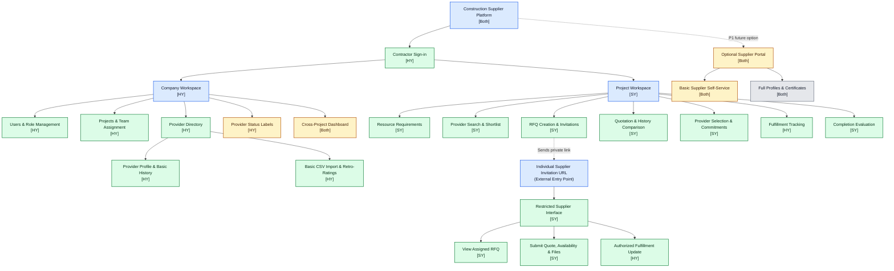
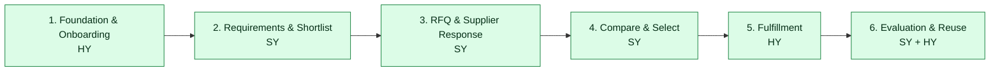

# Construction Supplier Collaboration & Decision-Support Platform

**Software Engineering in Construction Information Systems 
**Project:** Web-Based Collaboration and Decision-Support for Construction Suppliers  
**Team members:** Sesmiwati Binti Yusmadi Yusuf (SY) and Hsu, Yung-Tang (HY)  

## 1. Project overview

This project proposes a **private, contractor-controlled, web-based SaaS platform** for small- and medium-sized general contractors in Taiwan. It manages three construction-resource categories: **material suppliers**, **subcontractors/specialist service providers**, and **equipment/heavy-equipment providers**.

The platform connects **company-level provider knowledge** with **project-level procurement activities**. Contractors can retain supplier information and performance evidence across projects, while project teams define requirements, issue requests for quotation (RFQs), compare offers, record selections, monitor fulfillment, and evaluate provider performance. **People make provider-selection and contract-award decisions; the system provides decision support only.**

**Core knowledge loop:** Provider history → project requirement → shortlist → RFQ → supplier response → comparison → selection → fulfillment → evaluation → updated company knowledge → future reuse.

**Business model:** Contractors pay tiered SaaS subscriptions; basic supplier participation is free. The platform is **neither a public marketplace nor a replacement for ERP, BIM, accounting, payroll, or full project-management systems**.

## 2. Proposed website organization — primary Mermaid sitemap

The sitemap is the main diagram for Assignment #2. It shows **proposed pages, page groups, and entry points** (not database tables or backend jobs). **[SY]**, **[HY]**, and **[Both]** indicate *proposed leads*, subject to team confirmation.

**Color legend:** 🟩 **P0 / Must-have** — minimal MVP pages; 🟨 **P1 / Should-have** — later enhancements; ⬜ **P2 / Post-MVP** — deferred features; 🟦 **navigation groups or entry points** — organizational labels, not feature priorities.

**Important access interpretation:**

- Contractor login grants only the **company/project pages authorized by role, company, and project assignment**; showing two workspaces does not mean every internal user can enter both.
- The external supplier interface is **not linked from the public homepage**. A project procurement user sends an individual invitation containing a restricted, mobile-friendly URL. The dashed RFQ arrow indicates **invitation delivery**, not normal website navigation.
- A supplier can see only the designated RFQ and explicitly permitted follow-up actions. A fulfillment update may need a **new, separately authorized follow-up link** after provider selection. Suppliers cannot view competing quotes or internal evaluations.
- The P1 supplier portal is a **future alternative** to no-login links, not a prerequisite for P0. The P2 full-profile screen is shown only for future planning.
- Response timing, response-rate calculations, schedule variance, token verification, authorization, and persistence are **system behaviors**, not separate sitemap pages.

## 3. Target users and access boundaries

| Actor | Authorized scope | Proposed interface |
| --- | --- | --- |
| **Company Administrator** | Company account, users, roles, projects, and assignments | Internal company workspace |
| **Company Procurement / Supplier Manager** | Company-wide provider directory and performance history | Internal company workspace |
| **Project Manager** | Assigned projects; quotation review, selection, and evaluation | Internal project workspace |
| **Project Procurement Staff** | Assigned projects; requirements, shortlists, RFQs, and comparisons | Internal project workspace |
| **Supplier / Service Provider** | Only specifically authorized RFQ responses and subsequent permitted updates | Secure **no-login mobile link** (P0); optional portal (P1/P2) |

**Confidentiality rule:** Supplier-facing views must never expose competitors' quotations or contractor-only ratings, comments, and selection deliberations.

## 4. Planned pages and user-story traceability

The story references below follow **Section 11.1 (User Stories)** of the September 2026 proposal *as reported in the original README*. That README notes inconsistent identifiers in proposal Section 13; the referenced proposal should be checked before final submission. A page may implement more than one story.

| Planned page / interface | Principal role | User-story reference | Priority | Proposed lead |
| --- | --- | --- | --- | --- |
| Contractor sign-in; users and role management | Company Administrator | CA-02 | P0 | HY |
| Projects and team assignment | Company Administrator | CA-03 | P0 | HY |
| Provider directory; basic profile and history | Company Procurement Manager | CPM-01, CPM-04 | P0 | HY, with SY on metrics integration |
| **Basic CSV** import and labeled historical retro-ratings | Company Procurement Manager | CPM-02 | P0 | HY |
| Resource requirements | Project Procurement Staff | PPS-01 | P0 | SY |
| Provider search and shortlist | Project Procurement Staff | PPS-02 | P0 | SY |
| RFQ creation, invitations, and secure link issuance | Project Procurement Staff | PPS-03, PPS-04 | P0 | SY |
| Restricted RFQ view; quote, availability, and document submission | Supplier / Service Provider | SUP-01, SUP-02 | P0 | SY |
| Quotation and available provider-history comparison | Project Procurement Staff / Project Manager | PPS-05, PM-01 | P0 | SY |
| Manual provider selection and committed dates | Project Manager | PM-01, PM-02 | P0 | SY |
| **Fulfillment tracking and authorized supplier updates** | Project Manager / Supplier | PM-02, SUP-03 | P0 | **HY** |
| Brief post-completion evaluation | Project Manager | PM-03 | P0 | SY |
| Configurable provider status labels | Company Procurement Manager | Related to CPM-01; no separate story | P1 | HY |
| Cross-project dashboard | Company Procurement Manager | CPM-04 (expanded display) | P1 | Both |
| Optional basic supplier self-service portal | Supplier / Service Provider | Related to SUP-04 (limited scope) | P1 | Both |
| Full provider catalogs, profiles, and certificates | Supplier / Service Provider | SUP-04 | P2 | Both |

**Other requirements:** Subscription administration (**CA-01**) and proactive reminders (**PM-04**) are not P0 demonstration pages. Automated response-time and schedule-variance measurements are proposed P0 *system behaviors* (identified as SR-01/SR-02 in the original README); confidentiality requirements (SR-03/SR-04) are cross-cutting. Full story wording and IDs require final checking against the proposal.

## 5. MVP priorities and implementation boundaries

The **P0 business journey remains end-to-end**, but each capability is deliberately scoped to a small, demonstrable version suitable for a two-person implementation.

| Priority | Scope | Evidence of completion |
| --- | --- | --- |
| **🟩 P0 — Must-have** | Role/project access; provider directory; **basic CSV import** with required fields and simple, labeled retro-ratings; requirements and shortlist; RFQ and individual restricted response links; one quotation with optional file attachment per invited provider; simple side-by-side comparison; human selection and committed dates; milestone status/actual dates; automated response time and schedule variance when data exists; brief evaluation; company-history update | Demonstrate **import → requirement → RFQ → supplier response → comparison → selection → fulfillment → evaluation → reuse** using sample data |
| **🟨 P1 — Should-have** | Improved CSV/Excel import and duplicate detection; configurable status labels; cross-project dashboard; basic supplier self-service portal; usability enhancements | Add after the P0 workflow is stable |
| **⬜ P2 — Post-MVP** | Full supplier catalogs/certificates; predictive delay analytics; advanced multi-criteria scoring; ERP/API integration; broader workflow automation; **cost-variance reporting if comparable committed and actual cost data are captured** | Consider after pilot feedback and data availability |

**Scope decisions:**

- **Import:** P0 supports one documented CSV template and manual review of existing/history fields. Complex Excel parsing, bulk deduplication, and historical data migration are deferred.
- **RFQs and comparison:** P0 supports a simple quotation form and a transparent comparison table; no automatic contract award, payment processing, or sophisticated optimization.
- **Fulfillment:** P0 tracks a small set of committed versus actual milestone dates and authorized status updates, rather than a full construction schedule.
- **Metrics:** *Response time* = supplier submission timestamp − RFQ invitation timestamp; *schedule variance* = actual milestone date − committed milestone date. Display missing/unavailable values rather than fabricating performance scores. Label retro-ratings as subjective historical assessments.
- **Cost variance:** This is **not promised as an automatic P0 metric**. It requires defined baseline/committed price, actual cost, consistent scope and units, and clear handling of change orders; evaluate it for P2 when those data can be collected.
- **Supplier portal:** Proposal-reported distinction remains **P1 lightweight self-service** versus **P2 full profile maintenance**. SaaS subscription administration is a separate later commercial need, not P0.

## 6. P0 acceptance criteria (testable demonstrations)

These criteria are proposed **implementation tests**, not claims that the pages exist.

| ID | Feature / expected behavior | Acceptance criterion |
| --- | --- | --- |
| AC-01 | Role and project access | An assigned project user can access their project; an unassigned user is denied server-side access. |
| AC-02 | Provider onboarding | A valid sample CSV imports providers into the company directory; source-tagged retro-ratings remain distinguishable from system metrics. |
| AC-03 | Requirements and RFQ | Project Procurement Staff can save a requirement, shortlist providers, create an RFQ, and generate **provider-specific** invitation links. |
| AC-04 | Secure supplier response | An invited supplier can view only their assigned RFQ and submit price, availability, proposed dates, and an allowed file; an invalid or expired link is rejected. |
| AC-05 | Comparison and selection | Authorized project users can compare submitted quotations with available prior provider evidence; the Project Manager manually records the selected provider and committed dates. |
| AC-06 | Fulfillment | An authorized supplier can submit a permitted progress update, and the project workspace records actual milestone dates without exposing other RFQs. |
| AC-07 | Evaluation and reuse | After completion, a short evaluation and calculable response/schedule evidence appear in the company provider history and are available to another **authorized** project. |
| AC-08 | Data confidentiality | Supplier access does not reveal competing offers, confidential internal assessments, or another company's project records. |

## 7. Proposed division of responsibilities — confirmation required

The allocation below is a **working proposal, not an agreed team decision**. It balances user-facing functional areas more evenly while recognizing that effort also includes backend, security, integration, and testing. **HY provisionally leads fulfillment tracking and supplier progress updates**, transferred from the earlier draft; both teammates should approve this change.

| Work package | Proposed lead | Support / integration responsibility |
| --- | --- | --- |
| Repository structure, README coordination, navigation shell | **HY** | SY checks workflow/assignment consistency |
| Contractor authentication, role authorization, project assignments | **HY** | SY supplies role and project-access test cases |
| Company provider directory, basic CSV import, profiles, retro-ratings | **HY** | SY defines construction-resource fields |
| Requirements, provider shortlisting, RFQ setup, invitations | **SY** | HY connects directory, project permissions, and IDs |
| Restricted no-login supplier RFQ response and file submission | **SY** | HY reviews token/access design |
| Comparison matrix, manual selection, committed dates | **SY** | HY provides shared provider/quotation data contracts |
| **Fulfillment tracking, supplier progress updates, milestone persistence** | **HY** | SY supplies procurement/selection handoff and user acceptance scenarios |
| Response-time metrics, completion evaluation, knowledge-reuse display | **SY** | HY supplies stored milestones, schedule-variance logic, and provider-history persistence |
| End-to-end tests, security reviews, accessibility, integration demos | **Both** | Joint sign-off of each increment |
| P1/P2 pages | **Both (to be assigned later)** | Re-estimate only after P0 validation |

**Integration agreements before coding:** Agree on `companyId`, `projectId`, `providerId`, `rfqId`, `quotationId`, provider selection/commitment records, fulfillment milestones/statuses, token authorization rules, and where objective metrics are stored. Each module has one proposed lead; cross-module interfaces and reviews belong to both members.

## 8. Core user journey

1. **Company onboarding (HY):** The Company Administrator assigns users/projects; the Company Procurement Manager adds or imports existing providers, with clearly labeled historical ratings.
2. **Project sourcing (SY):** Project Procurement Staff define needs, search the contractor's private provider network, shortlist candidates, and issue RFQs.
3. **Supplier RFQ response (SY):** Individually invited providers use private, mobile-friendly links to submit quotations, availability, dates, and optional documents without creating accounts.
4. **Decision support (SY):** Authorized project users review comparisons and available provider history; the Project Manager **manually** selects a provider and records commitments.
5. **Fulfillment (HY):** Project staff monitor actual versus committed dates, with supplier updates allowed only through a properly scoped follow-up link or access path.
6. **Evaluation and knowledge reuse (SY + HY):** System-generated timestamps and milestone variances plus the Project Manager's structured evaluation update company history for reuse by other authorized projects.

## 9. Incremental development roadmap

| Increment | Demo outcome | Proposed lead | Acceptance criteria |
| --- | --- | --- | --- |
| 1 — Foundation and onboarding | Authorized company/project setup; sample provider CSV imported | HY | AC-01, AC-02 |
| 2 — Requirements and shortlist | Project team records a need and selects invited providers | SY | AC-03 (first half) |
| 3 — RFQ and supplier response | Supplier returns a valid quote through an individually restricted link | SY | AC-03, AC-04 |
| 4 — Comparison and selection | Project Manager reviews offers and records manual selection | SY | AC-05 |
| 5 — Fulfillment | Authorized updates produce actual milestones and schedule evidence | HY | AC-06 |
| 6 — Evaluation and reuse | Updated history is visible on a subsequent authorized project | SY + HY | AC-07, AC-08 |

**Development approach:** These are proposed increments, not fixed deadlines. Review each working increment with both teammates before expanding scope; re-plan if effort exceeds available time.

