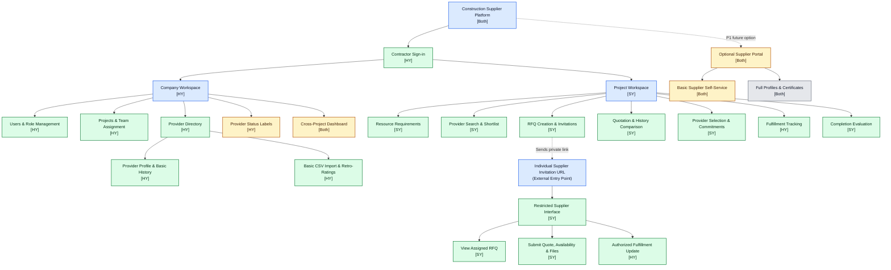

# Construction Supplier Collaboration & Decision-Support Platform

**Software Engineering in Construction Information Systems — Assignment #2**  
**Project:** Web-Based Collaboration and Decision-Support for Construction Suppliers  
**Team members:** Sesmiwati Binti Yusmadi Yusuf (SY) and Hsu, Yung-Tang (HY)  

## 1. Project overview

This project proposes a **private, contractor-controlled, web-based SaaS platform** for small- and medium-sized general contractors in Taiwan. It manages three construction-resource categories: **material suppliers**, **subcontractors/specialist service providers**, and **equipment/heavy-equipment providers**.

The platform connects **company-level provider knowledge** with **project-level procurement activities**. Contractors can retain supplier information and performance evidence across projects, while project teams define requirements, issue requests for quotation (RFQs), compare offers, record selections, monitor fulfillment, and evaluate provider performance. **People make provider-selection and contract-award decisions; the system provides decision support only.**

**Core knowledge loop:** Provider history → project requirement → shortlist → RFQ → supplier response → comparison → selection → fulfillment → evaluation → updated company knowledge → future reuse.

**Business model:** Contractors pay tiered SaaS subscriptions; basic supplier participation is free. The platform is **neither a public marketplace nor a replacement for ERP, BIM, accounting, payroll, or full project-management systems**.

## 2. Proposed website organization — primary Mermaid sitemap

The sitemap is the main diagram for Assignment #2. It shows **proposed pages, page groups, and entry points** (not database tables or backend jobs). **[SY]**, **[HY]**, and **[Both]** indicate *proposed leads*, subject to team confirmation.

**Color legend:** 🟩 **P0 / Must-have** — minimal MVP pages; 🟨 **P1 / Should-have** — later enhancements; ⬜ **P2 / Post-MVP** — deferred features; 🟦 **navigation groups or entry points** — organizational labels, not feature priorities.

**Important access interpretation:**

- Contractor login grants only the **company/project pages authorized by role, company, and project assignment**; showing two workspaces does not mean every internal user can enter both.
- The external supplier interface is **not linked from the public homepage**. A project procurement user sends an individual invitation containing a restricted, mobile-friendly URL. The dashed RFQ arrow indicates **invitation delivery**, not normal website navigation.
- A supplier can see only the designated RFQ and explicitly permitted follow-up actions. A fulfillment update may need a **new, separately authorized follow-up link** after provider selection. Suppliers cannot view competing quotes or internal evaluations.
- The P1 supplier portal is a **future alternative** to no-login links, not a prerequisite for P0. The P2 full-profile screen is shown only for future planning.
- Response timing, response-rate calculations, schedule variance, token verification, authorization, and persistence are **system behaviors**, not separate sitemap pages.

## 3. Target users and access boundaries

| Actor | Authorized scope | Proposed interface |
| --- | --- | --- |
| **Company Administrator** | Company account, users, roles, projects, and assignments | Internal company workspace |
| **Company Procurement / Supplier Manager** | Company-wide provider directory and performance history | Internal company workspace |
| **Project Manager** | Assigned projects; quotation review, selection, and evaluation | Internal project workspace |
| **Project Procurement Staff** | Assigned projects; requirements, shortlists, RFQs, and comparisons | Internal project workspace |
| **Supplier / Service Provider** | Only specifically authorized RFQ responses and subsequent permitted updates | Secure **no-login mobile link** (P0); optional portal (P1/P2) |

**Confidentiality rule:** Supplier-facing views must never expose competitors' quotations or contractor-only ratings, comments, and selection deliberations.
