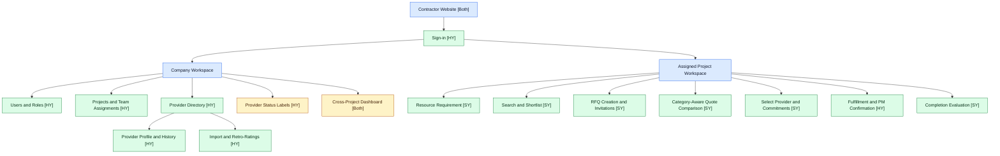
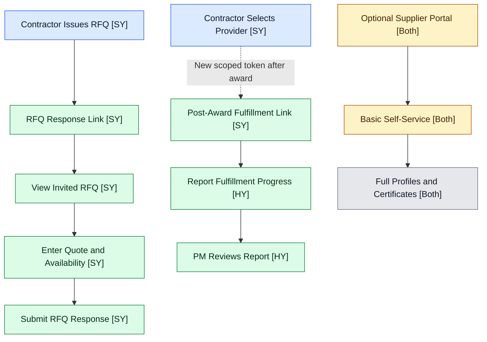

# Construction Supplier Collaboration & Decision-Support Platform

Software Engineering in Construction Information Systems  
**Project:** Web-Based Collaboration and Decision-Support for Construction Suppliers  
**Team members:** Sesmiwati Binti Yusmadi Yusuf (SY) and Hsu, Yung-Tang (HY)  

## 1. Project overview

This project plans a **private, contractor-controlled web application** for small- and medium-sized general contractors in Taiwan. It covers **material suppliers**, **subcontractors/specialist service providers**, and **equipment providers**. The platform connects company-level provider records to project-level procurement activities: requirement definition, provider shortlisting, requests for quotation (RFQs), responses, quotation comparison, provider selection, fulfillment, and post-engagement evaluation. Its decision-support functions assist rather than replace human procurement judgment.

**Knowledge loop:** Import existing provider knowledge → project requirement → shortlist → RFQ → supplier response → comparison → manual selection → fulfillment → contractor-confirmed outcome → evaluation → updated company provider history → future project reuse.

**Commercial model:** Contractors pay a tiered SaaS subscription; basic supplier participation is free, with no commission on quotations or awards. This is **not** a public marketplace or a replacement for ERP, BIM, payroll, accounting, or full project-management software.

## 2. Users, authorization boundaries, and entry points

| Role | Intended scope | Entry point |
|---|---|---|
| Company Administrator | Company configuration, users, roles, and project assignments | Authenticated contractor workspace |
| Company Procurement / Supplier Manager | Company-wide provider directory, initial historical tags, provider history | Authenticated contractor workspace |
| Project Manager | Assigned projects; compare proposals, select providers, verify fulfillment, evaluate | Authenticated project workspace |
| Project Procurement Staff | Assigned projects; requirements, shortlisting, RFQs, comparison | Authenticated project workspace |
| Supplier / Service Provider | Only its specific invitation or awarded engagement; no competitor quotations or contractor-only reviews | **Purpose-limited, passwordless mobile links**, not internal login |

**Tenant isolation:** Company A must not access Company B's records. Within a contractor, users receive only their authorized company and assigned-project access. These are **server-enforced** rules, not merely hidden menu items.

**Supplier access has two distinct purposes:** (1) an invitation-specific **RFQ response link**, and (2) a separately issued **post-award fulfillment update link**, only for the selected provider. Neither link grants general access to the contractor workspace.

## 3. Planned website organization (Mermaid)

Diagrams show **web pages or entry points**, not the database or background calculations. Each leaf shows proposed responsible lead: **[HY]**, **[SY]**, or **[Both]**. 

**Color meaning:** 🟩 **P0** = required MVP page; 🟨 **P1** = secondary enhancement; ⬜ **P2** = post-MVP; 🟦 = navigation grouping, not a feature-priority claim.

### 3.1 Internal contractor website

**Interpretation:** The login diagram expresses possible navigation, **not** universal access to both workspaces. Authorization decides which pages each user can use. Calculations such as response timing and schedule deviation occur behind these pages; they are not separate website pages.

### 3.2 External supplier access (separate authorization paths)

**Important:** The post-award link is **not a continuation of RFQ-link permission**. Awarding a provider triggers issuance of a separate permission for that awarded engagement. Unselected providers never receive fulfillment-update access. The optional portal is not necessary for no-login P0 participation.

## 4. MVP scope and quotation comparison

| Priority | Planned functionality | Test of completion |
|---|---|---|
| **P0 — Must-have** | Company/project access; provider directory for **all three categories**; initial provider records and simple retro-ratings; requirements, shortlist, RFQ, secure mobile response; manual selection; fulfillment reporting and PM confirmation; basic completion evaluation; system-recorded metrics and company history reuse | Demonstrate a complete requirement-to-reuse journey. **First detailed end-to-end example: materials.** |
| **P1 — Should-have** | Bulk CSV/Excel import refinements and duplicate detection; provider labels; cross-project dashboard; lightweight supplier self-service; expanded category-specific comparison templates | Improves scale and usability after core journey succeeds |
| **P2 — Post-MVP** | Full supplier catalogs/certifications, predictive analytics, advanced scoring, ERP/API integrations, automated contract-award decisions | Excluded from first MVP validation |

**Scope decision for the two-person implementation:** The source proposal treats CSV/Excel import as Must-have. This development plan retains the feature as the **target P0**, but allows a documented contingency: demonstrate manual entry of approximately ten sample providers if import threatens the integration deadline. That contingency is **a proposed deviation requiring team/lecturer approval**, not a silent reinterpretation of the proposal. Likewise, the proposal's basic supplier portal is Should-have (P1), and full profile management is Post-MVP (P2).

### Category-aware quotation fields

All categories share: provider identity, RFQ/requirement ID, quoted amount and currency, availability, lead/commitment date, quote validity, payment terms, and inclusions/exclusions. The **first P0 demonstration** should use a complete **materials** template. The data model should admit other categories without implying identical pricing bases.

| Resource category | Additional comparison fields | Comparability check |
|---|---|---|
| **Materials — first full demo** | Material specification, quantity, unit (e.g., ton, m³), unit price, delivery destination and terms | Same specification and units; distinguish unit price from total price |
| Subcontractors/services — subsequent template | Work scope, lump sum/unit rate, workforce capacity, duration, exclusions | Same defined scope, units, and inclusions; flag unpriced exclusions |
| Equipment — subsequent template | Equipment type/capacity, rental unit/duration, operator inclusion, mobilization cost | Same equipment requirement, rental basis, and included services |

**Comparison behavior:** Highlight missing fields or inconsistent units/scope as **“not directly comparable.”** Do not rank by raw price alone; display evidence and leave selection to the authorized Project Manager. Supporting quote files can be deferred from an initial working skeleton if a safe structured-text response is available; final P0 file-upload scope remains subject to scheduling and safe-upload tests.

## 5. Verified user-story traceability

Identifiers below are checked against **Section 11.1** of the September 2026 proposal, **not** its inconsistent Section 13 traceability table. This table refers to planned functions; a story may span multiple pages. *System requirements* SR-01–SR-04 in Section 11.2 are tracked separately, and SR-01/SR-02 concern metrics rather than security despite that section's heading.

| Website page / feature | Source user stories (Section 11.1) | Priority / note | Lead |
|---|---|---|---|
| Company sign-in, roles, permissions | **CA-02** | P0 | HY |
| Project creation and team assignments | **CA-03** | P0 | HY |
| Company subscription/account administration | **CA-01** | Later commercial scope | HY (proposed) |
| Provider directory, company provider record | **CPM-01** | P0 | HY |
| Provider import and historical tags | **CPM-02** | P0 target; manual-entry fallback requires approval | HY |
| Invite or onboard provider | **CPM-03** | P0, through RFQ invitations/basic provider registration | SY + HY |
| Cross-project performance dashboard | **CPM-04** | P1 dashboard; underlying provider history is P0 | Both |
| Requirement creation and shortlist | **PPS-01, PPS-02** | P0 | SY |
| RFQ issue and secure response-link generation | **PPS-03, PPS-04** | P0 | SY |
| Automatic comparison matrix | **PPS-05** | P0 (materials fully demonstrated) | SY |
| Review proposals against history and select provider | **PM-01** | P0 | SY |
| Committed dates and fulfillment tracking | **PM-02** | P0 | HY + SY |
| Post-completion evaluation | **PM-03** | P0 short form | SY |
| Delayed-response and delivery alerts | **PM-04** | Deferred; not a standalone P0 page | To assign |
| View RFQ from no-login link | **SUP-01** | P0 | SY |
| Upload/submit quote and availability | **SUP-02** | P0 target; safe file upload may be staged | SY |
| Report progress through **separate** post-award link | **SUP-03** | P0 | HY (page); SY (token) |
| Optional full self-managed profile | **SUP-04** | P2 full profile; P1 portal is a smaller, **related** future capability, not fulfillment of SUP-04 | Both |

**Nonfunctional/system requirements:** **SR-01** = response metrics, **SR-02** = schedule variance, **SR-03** = commercial confidentiality, **SR-04** = internal evaluation confidentiality. Every P0 integration must preserve SR-03 and SR-04.

## 6. Secure link lifecycle and data protection

**Proposed technical policy to validate before implementation:**

1. Generate cryptographically unpredictable bearer tokens and store only a **server-side hash** of each token. Use HTTPS and do not log raw tokens.
2. Bind each token to **contractor/tenant, provider, RFQ or awarded engagement, action/purpose**, and a defined validity window. Validate all boundaries on the server for every request.
3. **RFQ tokens** expire at the response deadline plus a **configurable grace period** (provisional default: 24 hours); revoke when an RFQ is cancelled, a provider's invitation is withdrawn, or the award makes the RFQ response obsolete. Exact timing must be approved by the team.
4. After selection, issue a **new fulfillment token** only to the selected provider for the relevant engagement. Revoke on completion, cancellation, access compromise, or reaward. Set a limited expiry with a renewal process for long-running engagements.
5. Maintain an audit record of invitation, submissions, selection, date confirmation, token issuance/revocation, and material changes. Do not expose tokens to third-party analytics or referrals.
6. Consider an out-of-band one-time code for fulfillment updates if usability and threat assessment justify it; it is not assumed in initial P0 scope. Forwarded bearer links remain a risk even when tokens are unguessable.
7. Validate and limit uploads (type, size, storage access); sanitize displayed content. Supplier users must never view competing quotes, private ratings, or unrelated projects.

**Personal and commercial data:** Supplier contact details and named evaluations should be collected only as needed, access-restricted, auditable, and subject to a retention/deletion policy. Confirm applicable Taiwan data-protection requirements with qualified guidance before deploying real customer data; this README does **not** claim legal compliance.

**Interface language (planning assumption):** Traditional Chinese first for Taiwan-based contractor and supplier workflows; English labels/help may be added when practical. Confirm language preferences during pilot interviews.

## 7. Performance-data integrity

The system can record events automatically, but **system-recorded does not mean independently verified**.

| Information | How it is obtained | Display / metric policy |
|---|---|---|
| RFQ invitation sent | Server timestamp | System-recorded timestamp |
| RFQ link first opened | First valid server-side link access (optional) | Only an **access event**, not proof a human read the invitation; scanners may prefetch links |
| Quotation submitted | Server timestamp | Report *invitation-to-submission elapsed time* rather than claiming observed human response latency |
| Fulfillment date reported | Supplier submission or site-staff draft | Label **supplier-reported / unconfirmed** |
| Actual fulfillment date confirmed | Authorized Project Manager verifies or corrects date | Only **PM-confirmed** actual dates enter confirmed schedule-deviation reporting |
| Legacy retro-rating | Internal staff judgment during onboarding | Label **historical subjective assessment**; never present as measured performance |

For confirmed records:

`Schedule deviation (days) = PM-confirmed actual fulfillment date − committed fulfillment date`

Display metric **sample size (n)** and the underlying observations where feasible. As a provisional design threshold, label aggregate provider-level rates **“insufficient data” for n < 5**; this is **a proposed display rule, not a statistical guarantee**, and should be tested with users. Do not build composite supplier rankings in P0. Different resource categories and RFQ requirements should not be treated as statistically interchangeable.

## 8. Implementation strategy and ownership

### Walking skeleton before feature expansion

**First integration checkpoint:** One contractor → one project → one provider → one RFQ → one secure link → one structured quote → one manual selection. This validates authentication, cross-module identifiers, token scope, storage, and basic navigation **before** broadening the feature set. It is a **technical milestone**, not the complete MVP.

### Provisional single-owner assignments

| Work package / contract | Primary lead | Dependency / support |
|---|---|---|
| Repository setup, contractor authentication, RBAC, tenant/project authorization | **HY** | SY writes cross-role misuse tests |
| Master provider database and provider IDs; fulfillment milestone model, persistence, PM confirmation page | **HY** | SY confirms fields used by sourcing/metrics |
| RFQ, supplier links **including both RFQ and fulfillment token issuance/validation/revocation** | **SY** | HY integrates authentication and persistence; shared threat review |
| Resource requirements, supplier quote page, category-aware comparison and award | **SY** | HY provides provider IDs and project access layer |
| **Metrics calculation and data provenance policy** | **SY** | HY provides committed, reported and PM-confirmed dates |
| Completion evaluation / history presentation | **SY** | HY persists company-owned provider history |
| Integrated tests, accessibility/usability, README/diagram review | **Both** | Joint acceptance |

**Interface agreement before coding:** Agree on identifiers (`company_id`, `project_id`, `provider_id`, `rfq_id`, `engagement_id`), authorization checks, quotation fields, link purposes, fulfillment status transitions, and which service owns each persisted value. SY owns the entire token lifecycle; HY owns fulfillment milestone persistence. No second, competing token implementation should be built in the fulfillment module.

### Increments, rough effort, dependencies, and security gates

*The estimates below are **relative team-effort ranges**, not promised calendar dates. Refine after repository setup and a working skeleton. Work may overlap once interfaces are agreed.*

| Increment | Deliverable | Indicative effort | Blocks / dependencies | Acceptance/security gate |
|---|---|---|---|---|
| **0. Walking skeleton** | One RFQ-to-quote-to-selection journey | **Small–medium** | Shared IDs, minimal access and storage | Isolated RFQ token cannot access unrelated data |
| **1. Foundation** | Auth, project scope, provider records | **Medium** | Base data model and role rules | Unauthorized company/project access fails (**AC-01**) |
| **2. Sourcing** | Requirements, shortlist, invitations | **Small–medium** | Provider directory + project access | Wrong-role creation/reading is rejected |
| **3. RFQ responses** | Secure mobile links, quote submission | **Medium–large** | Token service + RFQ model | **AC-04 / AC-08a** expiry, revocation, tenant isolation, confidentiality, upload validation |
| **4. Compare and select** | Materials comparison; award; new fulfillment authorization | **Medium** | Structured responses + award permissions | Flag non-comparable bids; only authorized PM awards; separate token issued |
| **5. Fulfillment/evaluation** | Supplier progress, PM confirmation, system-recorded metrics | **Medium** | HY milestone model + SY tokens/metrics | Unconfirmed dates excluded; supplier cannot edit approved dates |
| **6. Reuse and integration** | Cross-project provider history and final end-to-end validation | **Small–medium** | All prior increments | **AC-08b** cross-project reuse respects permissions |

**Cut line if time is limited (team/lecturer approval required):** Prioritize the walking skeleton, secure link separation, tenant isolation, one complete **materials** procurement journey, PM-confirmed data, and company-history reuse. Defer rich dashboards, the optional portal, advanced quote attachments, automated imports (using clearly marked demo records temporarily), and richer evaluation forms **before** dropping security or the core knowledge loop. Clearly state any departure from the source proposal's target Must-have scope in the final demonstration.

### Explicit dependency summary

| Dependency | Required collaboration |
|---|---|
| Project and provider identity → sourcing/RFQ | HY provides identifiers and authorization interface; SY consumes them |
| RFQ/award → supplier token lifecycle | SY issues purpose-specific links and enforces scope |
| Fulfillment report → confirmed outcome | HY persists reported and PM-confirmed states; SY computes metrics only from confirmed outcomes |
| Metrics/evaluation → reusable provider history | SY defines metrics and evaluation payloads; HY owns storage; both test cross-project visibility |

## 9. Testable acceptance criteria

The following criteria are **planned tests**, not test results. AC numbers are local to this README and do not replace the proposal's user-story IDs.

| ID | Acceptance criterion | Earliest gate |
|---|---|---|
| **AC-01** | A user assigned to Company A / Project A is denied server access to another company's data and unauthorized projects, even with manually altered URLs/IDs | Increment 1 |
| **AC-02** | A provider can be linked to the correct company and shortlisted for an authorized project | Increment 2 |
| **AC-03** | A supplier can submit a structured materials quotation without an account | Increment 3 |
| **AC-04** | Expired, revoked, wrong-provider, wrong-purpose, and cross-tenant tokens all fail; a follow-up token cannot submit a new RFQ quotation | Increment 3 and retested in 4–5 |
| **AC-05** | Missing units, mismatched specifications, or exclusions trigger a visible **not-directly-comparable** warning | Increment 4 |
| **AC-06** | Only an authorized Project Manager can record a provider award and confirm fulfillment | Increment 4–5 |
| **AC-07** | Supplier-reported dates do not appear as confirmed schedule-deviation evidence until PM confirmation; counts are displayed | Increment 5 |
| **AC-08a** | During initial supplier response, RFQ A token cannot read RFQ B, competitor bids, contractor comments/ratings, or another company's data; negative cases run before Increment 3 acceptance | Increment 3 |
| **AC-08b** | Authorized users can reuse company provider history across assigned projects without exposing unrelated company or project records | Increment 6 |
| **AC-09** | The full materials demo can complete sourcing through updated company history, with each change audit-recorded | Increment 6 |

## 10. Business and pilot validation

**Customer hypothesis (not market research):** Taiwan-based small and medium contractors handling several simultaneous projects and using fragmented supplier records are the initial pilot audience. The source proposal provides **indicative** subscription tiers (Starter, Growth, Professional, Enterprise); those figures are **pricing hypotheses**, not customer-validated willingness to pay. This README does not claim verified competitor pricing or market share.

**Substitutes to investigate:** Existing Excel/CSV files, phone/email/LINE communication, procurement features within ERP systems, and construction bid-management platforms. The team should interview contractor staff to learn which steps truly create duplication or delay before making comparative claims.

**Pilot success measures (baselines and targets to be determined with pilot users):**

- Time to prepare, send, collect, and compare one RFQ versus the contractor's current practice.
- Supplier RFQ completion rate without account registration and invitation-to-submission elapsed time.
- Number of imported/entered provider records actually reused in a second project.
- Share of completed engagements with PM-confirmed fulfillment dates.
- Contractor and supplier feedback on ease of use, including Traditional Chinese labels.

**Validation action:** Observe or interview a small sample of relevant contractors and invited suppliers; demonstrate one materials case and record baseline/current versus prototype workflow effort. Do not present proposed metrics as measured outcomes.

## 11. Assumptions, top risks, and non-goals

**Assumptions:** The pilot contractor permits use of non-sensitive demo information; selected suppliers can open mobile links; one materials case adequately exercises the first integration; team responsibilities and any P0 deferrals will be confirmed together.

| Risk | Mitigation |
|---|---|
| Link forwarding or token leakage | Scoped, revocable, time-limited server-validated bearer tokens; optional additional verification |
| False or incomplete supplier progress reports | Separate supplier-reported and PM-confirmed statuses; audit trail |
| Thin, subjective historical supplier information | Show source and `n`; avoid unsupported ranking; test actual day-one value |
| Non-comparable prices across categories | Category-specific fields and comparability warnings; one fully verified materials demonstration |
| Two-person capacity and coupled modules | Single owner per shared contract, early walking skeleton, approved cut line |
| Personal data and named negative evaluations | Limited access, documented provenance and retention; seek qualified local review |

**Non-goals for P0:** Public supplier discovery marketplace; automatic contract award; composite or AI-generated supplier rankings; payments/accounting/payroll; BIM; deep ERP integration; large scheduling system; and unrestricted supplier account access.
